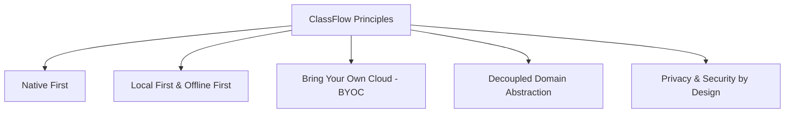

# ClassFlow System Architecture Specification

**Document Version**: 1.0.0 | **Phase**: 1 | **Status**: Active Design

---

## 1. Architectural Philosophy & Core Tenets

ClassFlow is engineered as a long-lived, open-source native application. Rather than treating it as a fleeting university demo, the architecture is structured around five foundational pillars:



1. **Native First**: No cross-platform runtime baggage (e.g. Flutter, React Native, or Electron). Native Swift 6 on macOS and Kotlin on Android preserve platform idioms, optimal memory footprints, and instant cold-starts.
2. **Local First**: Every user transaction commits immediately to the local embedded database (SQLite on macOS, Room on Android). The app is 100% operational in disconnected airplane mode.
3. **Bring Your Own Cloud (BYOC)**: Storage providers are completely decoupled from synchronization logic. Users retain absolute sovereignty over their data using personal object storage buckets.
4. **Decoupled Domain**: Courses are not shoehorned into generic calendar events, nor are calendar events retrofitted as academic courses. Both live as peer domain entities projected into a unified `TimelineItem` occurrence stream.
5. **Security by Design**: Sensitive cloud secrets are stored exclusively in platform cryptographic keychains and never enter the sync stream or logs.

---

## 2. Layered Architecture Overview

ClassFlow enforces strict unidirectional data flow and clean separation of concerns:

```mermaid
flowchart TD
    subgraph Presentation_Layer [Presentation Layer]
        MacUI[macOS: SwiftUI + AppKit]
        DroidUI[Android: Jetpack Compose + Material 3]
        Widgets[Widgets: WidgetKit + Glance]
        MenuBar[macOS Menu Bar Item]
    end

    subgraph Service_Layer [Service & Interaction Layer]
        TimelineRepo[TimelineRepository]
        CourseService[CourseService]
        SemesterService[SemesterService]
        CalendarService[CalendarService (Extensible)]
        ConflictDetector[ConflictDetectionService]
        BackupService[ImportExportService]
    end

    subgraph Domain_Layer [Domain & Engine Layer]
        TimelineEngine[Timeline & Occurrence Engine]
        CourseDomain[Course & Schedule Entities]
        CalendarDomain[Calendar & CalendarEvent Entities]
        RecurrenceEngine[Recurrence & Exception Rules]
    end

    subgraph Sync_Layer [Synchronization Layer (BYOC)]
        SyncEngine[SyncEngine (Append-Only Log Orchestration)]
        ConflictResolver[Deterministic Conflict Resolver]
        StorageProvider[StorageProvider Protocol]
        QiniuProvider[Qiniu Kodo S3 Adapter]
        WebDAVProvider[WebDAV Adapter (Future)]
    end

    subgraph Persistence_Layer [Persistence & Platform Enclaves]
        LocalDB[(Local SQLite / Room)]
        SecureEnclave[macOS Keychain / Android KeyStore]
        SystemCalendarBridge[EventKit / Android Calendar Provider]
    end

    Presentation_Layer --> Service_Layer
    Service_Layer --> Domain_Layer
    Service_Layer --> Sync_Layer
    Service_Layer --> Persistence_Layer
    Sync_Layer --> StorageProvider
    StorageProvider --> QiniuProvider
    StorageProvider --> WebDAVProvider
```

---

## 3. Domain Model Decomposition: Course vs. CalendarEvent

A critical architectural pitfall in student timetable applications is either treating everything as a Google Calendar event (losing semester terms, teaching weeks, and section numbers) or treating all future events as academic courses. ClassFlow resolves this through strict separation:

```
Calendar (Collection / Container)
  │
  ├── CalendarEvent (Generic Schedule: Exam, Meeting, Club Activity, Reminder)
  │     ├── recurrenceRule: RecurrenceRule?
  │     └── reminders: [Reminder]
  │
  └── Course (Academic Entity: Subject Name, Teacher, Color, Semester ID)
        ├── CourseSchedule (Regular Schedule Rules: DayOfWeek, Sections, WeekPattern)
        └── ScheduleException (Overrides: Reschedule, Cancel, Makeup, Room Change)
```

### 3.1 Unified Occurrence Projection (`TimelineItem`)
The UI layer (weekly timetable grid, agenda feed, desktop widgets) does not directly query raw database tables. Instead, it queries the `TimelineRepository`:

```swift
protocol TimelineRepository {
    func getOccurrences(from startDate: Date, to endDate: Date) async throws -> [TimelineItem]
}
```

Every item returned is a concrete `TimelineItem`:
- **Identity**: Globally stable `id` deterministically generated as `${sourceType}_${sourceId}_${dateStamp}`.
- **Visual Attributes**: Title, location string, start/end timestamps, visual color, opacity/dim status.
- **Semantics**: Section range (e.g. Sections 1–2), current week relevance (current week vs non-current week), and status tags (`normal`, `cancelled`, `rescheduled`, `makeup`).
- **Editing Dispatch**: When the user taps a `TimelineItem`, the UI inspects `item.sourceType`:
  - If `.course(courseId, scheduleId)`: Dispatches to `CourseEditCoordinator`.
  - If `.calendarEvent(eventId)`: Dispatches to `CalendarEventEditCoordinator` (Phase 2+ interface).

---

## 4. Platform Architectural Specifications

### 4.1 macOS Architecture
- **Language**: Swift 6 with strict concurrency (`@MainActor`, `Sendable`).
- **UI Engine**: Pure SwiftUI 6 lifecycle, with AppKit (`NSViewRepresentable`, `NSWindow`, `NSMenu`) for precise desktop toolbar controls, window frame management, and menu bar extras.
- **Database**: SQLite3 via a lightweight, type-safe Swift driver with WAL mode (Write-Ahead Logging).
- **System Integration**:
  - `EventKit`: One-way calendar synchronization with mapping tables (`CalendarMapping`).
  - `WidgetKit`: TimelineProvider feeding Next Class, Today's Classes, and Week Overview widgets.
  - `UserNotifications`: Local scheduled notifications for class warnings and daily summaries.

### 4.2 Android Architecture
- **Language & Runtime**: Modern Kotlin 2.x targeting Android 16/17 (API 36/37) with minSdk 26.
- **UI Engine**: Jetpack Compose using Material 3 with adaptive layouts supporting smartphones, foldables, and tablets.
- **Database**: Room Persistence Library with Kotlin Coroutines Flow.
- **System Integration**:
  - Android Calendar Provider: Managed via `ContentResolver` with stable recurring mapping identifiers.
  - Glance / AppWidget: Jetpack Glance powering 2×2 Next Class, 4×2 Day Schedule, and 4×4 Week Timetable.
  - HyperOS Adapter Module (`apps/android/hyperos-adapter`):
    - Public notification channel extras (`miui.focus.param`).
    - Guarded by explicit runtime permission and registered App ID check.
    - Graceful fallback to standard `NotificationCompat` when permissions are ungranted or platform is non-Xiaomi.

---

## 5. Security Architecture

1. **Zero Secret Leakage**:
   - Cloud credentials (`AccessKey`, `SecretKey`, Passwords) are strictly forbidden from database dumps, `.classflow` backups, and telemetry.
   - Credentials exist only in macOS Keychain and Android KeyStore.
2. **Deterministic Hashing**:
   - Revision hashes are computed using SHA-256 over canonical JSON encodings (sorted keys, UTF-8).
3. **Optional Credential Broker**:
   - For users desiring multi-device sync without distributing root cloud keys to mobile devices, an optional lightweight self-hosted microservice (`services/credential-broker`) can issue scoped, short-lived STS tokens.

## 6. ChatGPT Automation (macOS)

Local Work/Codex plugins and private Secure MCP Tunnel connections share the same
stdio MCP server. The desktop AppState executes commands through a same-user,
0700-protected mailbox and acknowledges results. MCP mutations enter the App's sync
operation stream; cloud credentials remain in Keychain. Focus runtime state is kept
in a separate local `focusSession`, never in timetable profile IDs or cloud payloads.
See [ChatGPT integration](CHATGPT_INTEGRATION.md) for setup, tool coverage, and separate
local/ChatGPT end-to-end verification requirements.

The native AI settings optionally own an official tunnel-client subprocess. TunnelManager
uses generation-scoped startup/cancellation, an exclusive close-on-exec process lock,
loopback readiness probes and bounded termination. Startup is opt-in and construction
never reads Keychain. Runtime keys live only in Keychain and the child environment;
connection preferences and private profiles are device-local and excluded from sync.

Calendar migration uses an atomic MCP batch (up to 500 expanded occurrences), content-based duplicate adoption, and device-local replay receipts committed alongside events. AppState journals inserted events and preserves receipts during ordinary saves. Receipts are excluded from sync/backup and do not represent ongoing external calendar synchronization.


### MCP editing v1.2

The 28-tool contract is shared by stdio and HTTP/OpenAPI. Validated editing handlers retain UUIDs for in-place changes, split future series and detach individual calendar occurrences, and journal all changes through AppState. CalendarEvent.timeMode is optional for backwards compatibility; `sections` binds the event to the semester's current SectionTime values, while legacy timestamps retain their concrete times. CalendarEventProjector is shared by native Mac views, MCP, widgets and reminder planning; Android mirrors recurrence/count/day-clipping semantics and persists the new fields. TaskRecurrence generates one stable-ID successor on completion without inventing focus statistics. batch_edit_items stages only allowed data mutations in a private temporary database, commits atomically, and saves device-local replay receipts. Full editing context excludes settings and credentials and is paginated. FocusSession may contain optional course metadata and location; it remains device-local. See CHATGPT_INTEGRATION.md for scope and runtime verification boundaries.
