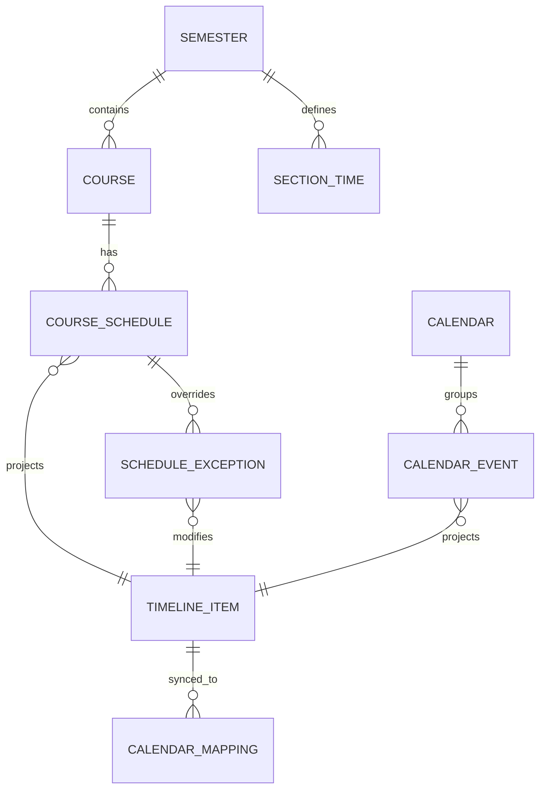
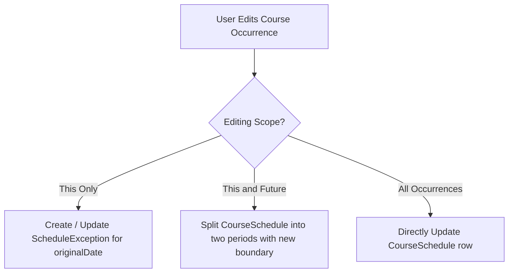

# ClassFlow Domain Data Model Specification

**Version**: 1.0.0 | **Phase**: 1 | **Status**: Active Design

---

## 1. Domain Entities & Relationships

The ClassFlow domain model cleanly separates academic course structures from generic calendar events while providing a unified projection into the runtime timeline:



---

## 2. Core Entity Definitions

### 2.1 `Semester` (学期)
Manages the academic calendar boundaries, weekly cadence, and daily section time slots.

| Field | Type | Description | Constraints |
| :--- | :--- | :--- | :--- |
| `id` | `UUID` (String) | Globally unique identifier | Primary Key |
| `name` | `String` | Human-readable semester name | e.g. "2026-2027 秋季学期", max 50 chars |
| `startDate` | `String` (ISO 8601 Date) | Monday of the first teaching week | Format: `YYYY-MM-DD` |
| `endDate` | `String` (ISO 8601 Date) | Official closing date of the semester | Must be >= `startDate` |
| `totalWeeks` | `Int` | Total number of teaching weeks | Range: `1..30`, default: `20` |
| `isCurrent` | `Boolean` | Flag indicating the active semester | Exactly one semester should be active |
| `timeZone` | `String` | IANA Timezone identifier | e.g. `"Asia/Shanghai"` |
| `sections` | `[SectionTime]` | Configurable daily section schedule | Ordered list of 1..N periods |

#### Sub-object: `SectionTime` (节次时间)
- `section`: `Int` (1-indexed period number, e.g. 1, 2, 3...)
- `startTime`: `String` ("HH:mm", 24-hour format, e.g. "08:00")
- `endTime`: `String` ("HH:mm", 24-hour format, e.g. "08:45")

---

### 2.2 `Course` (课程)
Represents the educational subject itself, independent of specific recurring calendar time-slots.

| Field | Type | Description | Constraints |
| :--- | :--- | :--- | :--- |
| `id` | `UUID` (String) | Globally unique identifier | Primary Key |
| `semesterId` | `UUID` (String) | Foreign key to `Semester` | Required |
| `name` | `String` | Course name | e.g. "高等数学", max 100 chars |
| `teacher` | `String?` | Instructor name | Optional, max 50 chars |
| `color` | `String` | Hex color code | Format: `#RRGGBB` or `#RRGGBBAA` |
| `notes` | `String?` | General notes, exam info, course links | Optional, max 1000 chars |
| `createdAt` | `String` (ISO 8601 DateTime)| Creation timestamp | UTC |
| `updatedAt` | `String` (ISO 8601 DateTime)| Last modification timestamp | UTC |

---

### 2.3 `CourseSchedule` (常规上课安排)
Specifies the recurring weekly pattern for a course during a semester. A single course may have multiple schedules (e.g. Monday 1-2 in Room A101, and Thursday 3-4 in Lab B202).

| Field | Type | Description | Constraints |
| :--- | :--- | :--- | :--- |
| `id` | `UUID` (String) | Globally unique identifier | Primary Key |
| `courseId` | `UUID` (String) | Foreign key to `Course` | Required |
| `dayOfWeek` | `Int` | Day of week | `1` (Monday) through `7` (Sunday) |
| `startSection` | `Int` | Starting period number | Must be <= `endSection` |
| `endSection` | `Int` | Ending period number | Must be >= `startSection` |
| `classroom` | `String?` | Location / Room name | Optional, max 50 chars |
| `weekPattern` | `WeekPattern` | Weekly recurrence rule | See specification below |

#### Sub-object: `WeekPattern` (周次规则)
- `type`: `"all"` (每周) | `"odd"` (单周) | `"even"` (双周) | `"custom"` (自定义)
- `customWeeks`: `[Int]?` (Explicit list of active weeks, e.g. `[1, 2, 3, 4, 5, 7, 9, 10, 11]`, sorted ascending, range `1..30`)

---

### 2.4 `ScheduleException` (课程安排例外规则)
Captures ad-hoc single-occurrence or date-specific alterations: class cancellations, room relocations, or rescheduled times.

| Field | Type | Description | Constraints |
| :--- | :--- | :--- | :--- |
| `id` | `UUID` (String) | Globally unique identifier | Primary Key |
| `scheduleId` | `UUID` (String) | Foreign key to `CourseSchedule` | Required |
| `originalDate` | `String` (ISO Date) | Date the exception applies to | `YYYY-MM-DD` |
| `exceptionType` | `String` | Type of adjustment | `"cancel"`, `"reschedule"`, `"makeup"`, `"room_change"` |
| `targetDate` | `String?` (ISO Date) | Rescheduled destination date | Required for `"reschedule"` & `"makeup"` |
| `targetDayOfWeek`| `Int?` | New day of week (`1..7`) | Used when date is moved |
| `targetStartSection`| `Int?` | New starting section | `1..N` |
| `targetEndSection`| `Int?` | New ending section | Must be >= `targetStartSection` |
| `targetClassroom` | `String?` | New room location | Optional |
| `reason` | `String?` | Explanation for override | Optional (e.g. "教师因病请假") |

---

### 2.5 `Calendar` & `CalendarEvent` (通用日程扩展接口)
Pre-architected domain models reserved for Phase 2+ general calendar features.

#### `Calendar`
- `id`: `UUID`
- `name`: `String` (e.g. "学业考试", "个人日程")
- `color`: `String` (Hex)
- `isDefault`: `Boolean`

#### `CalendarEvent`
- `id`: `UUID`
- `calendarId`: `UUID`
- `title`: `String`
- `startTime`: `String` (ISO 8601 DateTime)
- `endTime`: `String` (ISO 8601 DateTime)
- `isAllDay`: `Boolean`
- `location`: `String?`
- `recurrenceRule`: `String?` (Standard iCalendar RFC 5545 RRULE string)

---

## 3. Unified Timeline & Occurrence Projection

### 3.1 `TimelineItem` Projection Specification
The presentation layers consume unified `TimelineItem` projections calculated dynamically across a query range `[startDate, endDate]`:

```json
{
  "id": "course_occ_c4b92b60_2026-10-19",
  "sourceType": "course",
  "courseId": "9fa8733b-8761-4fa3-9f50-ff3e107bb4c1",
  "scheduleId": "c4b92b60-449e-4a6b-9ee7-25e1a1795db2",
  "title": "高等数学",
  "location": "东九楼 D102",
  "date": "2026-10-19",
  "dayOfWeek": 1,
  "startSection": 1,
  "endSection": 2,
  "startTime": "2026-10-19T08:00:00+08:00",
  "endTime": "2026-10-19T09:35:00+08:00",
  "weekNumber": 8,
  "isCurrentWeek": true,
  "status": "normal",
  "color": "#4F46E5",
  "teacher": "张教授",
  "notes": null
}
```

### 3.2 Editing Scope Mechanics
When editing a recurring course, users select an `EditingScope`:



1. **`thisOnly` (仅修改本次)**:
   - Preserves original `CourseSchedule`.
   - Inserts or replaces a `ScheduleException` referencing `scheduleId` and `originalDate`.
2. **`thisAndFuture` (修改本次及后续)**:
   - Adjusts the original `CourseSchedule.weekPattern` to truncate at `currentWeek - 1`.
   - Generates a new `CourseSchedule` entry starting at `currentWeek` through `totalWeeks`.
3. **`all` (修改全部安排)**:
   - Updates the underlying `CourseSchedule` directly. Any existing single-instance `ScheduleException` rows can either be retained or optionally cleared upon user confirmation.

---

## 4. Conflict Detection Rules

- **Principle**: Time overlaps are **permitted** (e.g. selective courses, overlapping seminars), but must produce clear, non-blocking visual warnings.
- **Conflict Algorithm**:
  1. For any date $D$, project all active `TimelineItem` instances where `status != "cancel"`.
  2. Detect pair $(A, B)$ where $[A.startTime, A.endTime) \cap [B.startTime, B.endTime) \neq \emptyset$.
  3. Mark occurrences with `hasConflict: true` and attach `conflictingItemIds: [B.id]`.
  4. Display an alert badge in the UI card header without blocking user save actions.

---

## 5. System Calendar Mapping (`CalendarMapping`)

To guarantee idempotent two-way/one-way synchronization with macOS `EventKit` and Android `CalendarProvider`:

| Field | Type | Description |
| :--- | :--- | :--- |
| `id` | `UUID` (String) | Mapping record key |
| `sourceType` | `String` | `"course_occurrence"` or `"calendar_event"` |
| `sourceId` | `String` | Deterministic occurrence ID |
| `calendarId` | `String` | System calendar target identifier |
| `externalEventId` | `String` | System event ID generated by OS provider |
| `lastSyncedRevision` | `Int` | Data revision at time of sync |
| `lastSyncedAt` | `String` (ISO DateTime) | Last synchronization timestamp |
