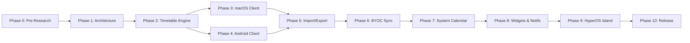

# ClassFlow Engineering Roadmap (Phases 0 - 10)

**Version**: 1.0.0 | **Author**: ClassFlow Core Team | **Status**: Active

---

## Roadmap Overview

---

## Phase Breakdown & Deliverables

### Phase 0: Technical Pre-Research & Environment Verification
- **Objectives**: Inspect host toolchains (macOS, Swift, Xcode, Java, Android SDK). Research HyperOS 3/4 and Xiaomi Super Island official APIs. Research Qiniu Kodo object storage S3-compatible APIs.
- **Deliverables**: `docs/FEASIBILITY.md` with explicit `[VERIFIED]`, `[UNVERIFIED]`, and `[BLOCKED]` status tagging.
- **Status**: **COMPLETED (Phase 0)**.

### Phase 1: Project Initialization & Architectural Design
- **Objectives**: Establish repository layout, agent guidelines, formal data models, sync protocol, design system, test plan, and architecture decision records (ADRs).
- **Deliverables**:
  - `AGENTS.md`, `README.md`, `LICENSE.md`
  - `docs/ARCHITECTURE.md`, `docs/DATA_MODEL.md`, `docs/SYNC_PROTOCOL.md`
  - `docs/DESIGN_SYSTEM.md`, `docs/ROADMAP.md`, `docs/TEST_PLAN.md`
  - `docs/ADR/` (ADR 0001, 0002, 0003)
  - `packages/schemas/` & `packages/fixtures/`
  - Foundational schema & projection verification test suite.
- **Status**: **COMPLETED (Phase 1)**.

### Phase 2: Core Timetable Calculation Engine & Schemas
- **Objectives**: Implement the pure domain timetable engine:
  - Week calculation (Semester start date -> current week index).
  - Odd/even/custom week filtering.
  - Multi-section span calculation.
  - `ScheduleException` resolution (cancel, reschedule, room change).
  - Non-blocking conflict detection algorithm.
  - Unified `TimelineItem` projection generator.
- **Deliverables**: Portable domain engine `packages/core-engine` (Swift 6 strict concurrency, Apple Silicon native) with 100% automated test coverage (27 unit tests).
- **Status**: **COMPLETED (Phase 2)**.
- **Dependencies**: Phase 1.

### Phase 3: macOS Native Client
- **Objectives**: Build the native macOS application:
  - Full-width 7-column timetable canvas with section time axis.
  - Custom macOS window toolbar (semester selector, week navigator, today shortcut).
  - Semi-transparent frosted course cards with custom palette and background image support.
  - Non-modal popover course inspection card.
  - Native macOS Settings window (General, Appearance, Timetable).
  - Menu Bar extra companion.
- **Deliverables**: Native macOS client `apps/macos` (SwiftUI 6 + AppKit, Apple Silicon arm64 native) with full timetable grid, popover, edit sheet, add sheet, settings window, menu bar companion, and automated view model tests.
- **Status**: **COMPLETED (Phase 3)**.
- **Dependencies**: Phase 2.

### Phase 4: Android / HyperOS Native Client
- **Objectives**: Build the native Android application:
  - Jetpack Compose 7-column timetable canvas with swipeable week pager.
  - 3-tab bottom navigation (`课程表`, `日程`, `我的`).
  - Bottom sheet course details and editing coordinator.
  - Material 3 theme with HyperOS font dynamic weight integration.
  - Local database persistence via Room.
- **Deliverables**: Android APK targeting API 34+ (HyperOS 3/4 verified).
- **Dependencies**: Phase 2.

### Phase 5: Import & Export Protocol
- **Objectives**: Implement native backup and calendar file interoperability:
  - `.classflow` format: Versioned ZIP archive containing JSON manifest, semesters, courses, schedules, exceptions, and UI preferences.
  - `.ics` export: RFC 5545 iCalendar generator with VEVENT instances for academic schedules.
  - `.ics` import: Parsing generic iCalendar files and projecting them into timetable or calendar occurrences.
  - Verification with real sample files (e.g. university export or WakeUp format).
- **Deliverables**: Complete import/export engine with preview and merge validation.
- **Dependencies**: Phase 3, Phase 4.

### Phase 6: Bring Your Own Cloud (BYOC) Cloud Sync
- **Objectives**: Implement decentralized cloud sync:
  - `StorageProvider` interface implementation for Qiniu Cloud Kodo via AWS S3 SigV4.
  - Device-isolated append-only log synchronization (`devices/{deviceId}/revisions/`).
  - Checkpoint manifests and compact snapshot generation.
  - Deterministic 3-way merge conflict resolution.
  - Secure credential storage in macOS Keychain and Android KeyStore.
  - Sync status indicator and conflict review UI.
- **Deliverables**: Operational multi-device synchronization engine tested across Mac and Android.
- **Dependencies**: Phase 5.

### Phase 7: System Calendar Integration
- **Objectives**: Implement one-way synchronization to OS calendars:
  - macOS: `EventKit` integration with calendar creation and permission handling.
  - Android: `CalendarContract` integration.
  - `CalendarMapping` tracking table preventing duplicate events.
  - Re-sync and automatic cleanup upon course schedule modification.
- **Deliverables**: Seamless projection of timetable occurrences into macOS Calendar and Android Calendar.
- **Dependencies**: Phase 3, Phase 4.

### Phase 8: Notifications & Desktop Widgets
- **Objectives**: Timetable awareness outside the main window:
  - macOS `UserNotifications`: Configurable pre-class alerts (e.g. 15 min / 5 min before start), classroom change alerts.
  - Android Notifications: Public notification channels, standard ongoing notifications during class.
  - Desktop Widgets:
    - macOS WidgetKit: Small (Next Class), Medium (Today), Large (Week Overview).
    - Android Glance / AppWidget: 2×2, 4×2, 4×4 widgets.
- **Deliverables**: Widget extensions and automated background reminder dispatchers.
- **Dependencies**: Phase 7.

### Phase 9: Xiaomi Super Island & HyperOS Adaptation
- **Objectives**: Specialized HyperOS features:
  - Validate registered App ID and developer permissions for Super Island.
  - Implement `SuperIslandAdapter` injecting `miui.focus.param` payload.
  - Support Island Summary, Expanded Island, and Lock Screen Focus notifications.
  - Graceful fallback to standard notifications when unverified or blocked.
- **Deliverables**: HyperOS adaptation module verified on physical HyperOS devices.
- **Dependencies**: Phase 8.

### Phase 10: Quality Assurance, UI Polish & Open Source Release
- **Objectives**: Prepare for public GitHub release:
  - Comprehensive end-to-end testing, UI polish, accessibility labels (VoiceOver / TalkBack).
  - Open source licensing finalization (confirming Apache 2.0).
  - `CONTRIBUTING.md`, `SECURITY.md`, `CHANGELOG.md`, Issue & PR templates.
  - GitHub Actions CI matrix (linting, schema validation, tests).
- **Deliverables**: Public release tag `v1.0.0` with full source code and documentation.
- **Dependencies**: Phases 0–9.
