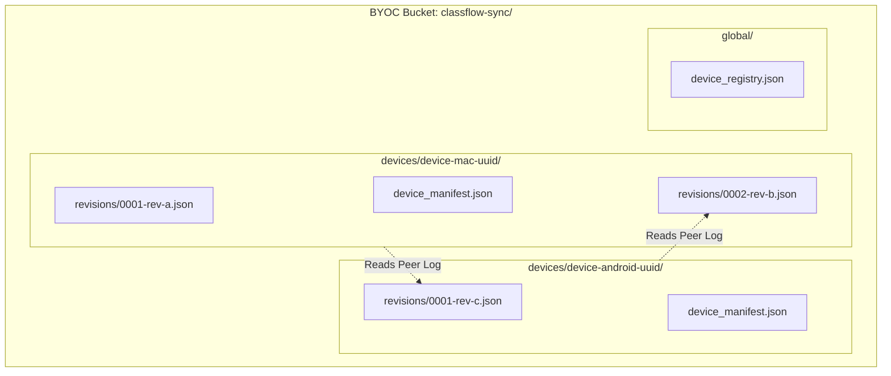
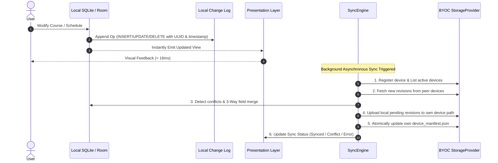
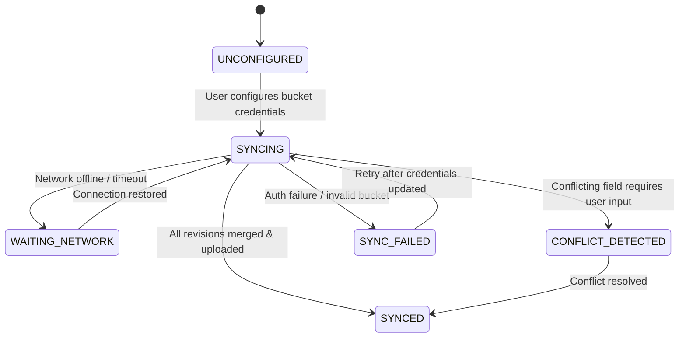

# ClassFlow BYOC Synchronization Protocol Specification

**Version**: 1.0.0 | **Phase**: 1 | **Status**: Active Design

---

## 1. Architectural Philosophy: Local-First & Device-Isolated Storage

In a **Bring Your Own Cloud (BYOC)** topology, user data resides on commodity object storage (such as Qiniu Cloud Kodo, AWS S3, or MinIO). Unlike enterprise databases with ACID transactions and distributed locks, object storage only supports atomic single-object PUTs and eventual consistency.

> [!WARNING]
> **The Last-Write-Wins (LWW) Single-File Hazard**  
> If multiple devices (e.g. Mac and Android phone) concurrently upload a single `timetable.json` file, the later upload silently obliterates changes made by the other device. ClassFlow **strictly prohibits** single-file overwriting sync.

To solve this, ClassFlow implements a **Device-Isolated Append-Only Log with Periodic Checkpoints**:



Each device writes exclusively to its own directory (`devices/{deviceId}/`). Devices never write or delete objects belonging to other devices.

---

## 2. Component Separation: `StorageProvider` vs. `SyncEngine`

To maintain clean modular boundaries, storage I/O is completely decoupled from business synchronization logic.

### 2.1 `StorageProvider` Protocol
Responsible solely for transport-level object storage operations:

```swift
protocol StorageProvider: Sendable {
    func validateConfiguration() async throws -> ConfigurationValidationResult
    func testConnection() async throws -> ConnectionHealth
    func readObject(path: String) async throws -> Data
    func writeObject(path: String, data: Data, metadata: [String: String]?) async throws
    func deleteObject(path: String) async throws
    func listObjects(prefix: String) async throws -> [StorageObjectSummary]
    func getObjectMetadata(path: String) async throws -> StorageObjectMetadata
}
```

Implementations:
- `QiniuS3StorageProvider`: AWS SigV4 compatible client communicating with Qiniu Kodo S3 endpoints (Phase 6).
- `GenericS3StorageProvider`: Standard S3 endpoints (Cloudflare R2, MinIO, AWS S3).
- `WebDAVStorageProvider`: RFC 4918 WebDAV HTTP methods (Future).

### 2.2 `SyncEngine`
Coordinates local state tracking, peer discovery, delta calculation, conflict detection, and merge execution.

---

## 3. The 8-Step Synchronization Lifecycle

Every user change adheres to the local-first lifecycle:



---

## 4. Revision & Manifest Formats

### 4.1 Local Change Operation (`SyncOperation`)
Every database mutation generates an immutable operation record:

```json
{
  "opId": "0f622dc3-34e2-45e3-982d-bf7291a50438",
  "deviceId": "dev_mac_7a9f4c",
  "sequence": 42,
  "timestamp": "2026-10-14T08:15:30.123Z",
  "entityType": "course",
  "entityId": "9fa8733b-8761-4fa3-9f50-ff3e107bb4c1",
  "action": "UPDATE",
  "payload": {
    "name": "高等数学 (重修班)",
    "teacher": "张教授",
    "color": "#4F46E5"
  },
  "clientVectorClock": {
    "dev_mac_7a9f4c": 42,
    "dev_droid_1b2c3d": 18
  }
}
```

### 4.2 Device Manifest (`device_manifest.json`)
Located at `devices/{deviceId}/device_manifest.json`:

```json
{
  "schemaVersion": 1,
  "deviceId": "dev_mac_7a9f4c",
  "deviceName": "MacBook Pro",
  "clientVersion": "1.0.0",
  "lastUpdated": "2026-10-14T08:15:32Z",
  "latestSequence": 42,
  "latestRevisionFile": "revisions/0042_0f622dc3.json",
  "snapshotFile": "snapshots/snapshot_seq40.json"
}
```

### 4.3 Compact Snapshots
When operation logs exceed 100 entries, the originating device creates a unified snapshot:
`devices/{deviceId}/snapshots/snapshot_seq{N}.json`.
Old revision files prior to `{N}` can be safely pruned, keeping bucket storage lightweight.

---

## 5. Conflict Resolution Matrix

When concurrent edits occur across devices while offline, ClassFlow applies deterministic 3-way merge rules:

| Conflict Scenario | Resolution Strategy | User Impact |
| :--- | :--- | :--- |
| **Different Courses edited concurrently** | Automatic 3-way merge | Seamless union of both courses. |
| **Same Course, different fields edited**<br>(e.g. Device A edits teacher, Device B edits color) | Automatic field-level merge | Both edits preserved. |
| **Same Course, same field edited**<br>(e.g. Device A sets room A101, Device B sets room B202) | Hybrid Logical Clock (HLC) with tie-breaker; marked as soft conflict | Latest timestamp wins automatically; conflict banner offers one-click review to pick desired value. |
| **Delete vs. Modify Conflict**<br>(Device A deleted course, Device B modified schedule) | Modify wins; restore entity | Course is preserved with a warning notification ("已恢复在另一设备上修改的课程"). |
| **Duplicate Course Import** | Content-hash idempotency match | Duplicate skipped cleanly. |

---

## 6. Sync Engine State Machine

The synchronization engine presents a transparent state machine exposed to UI indicators:



---

## 7. Credential Protection & Security Boundaries

1. **Local Enclaves**:
   - Access Key & Secret Key are strictly stored in macOS Keychain (`kSecClassGenericPassword`) and Android KeyStore (`EncryptedSharedPreferences`).
   - Plaintext keys are never serialized into SQLite, Room, or log files.
2. **Minimal Permissions Guidance**:
   - The user setup guide advises creating a dedicated Qiniu / S3 bucket and sub-account with `PutObject`, `GetObject`, `ListBucket`, and `DeleteObject` restricted to the `classflow-sync/*` prefix.
3. **Optional Credential Broker (`services/credential-broker`)**:
   - Users who do not want root AK/SK on mobile devices can deploy an optional 50-line microservice generating temporary STS credentials with 1-hour expiration.
